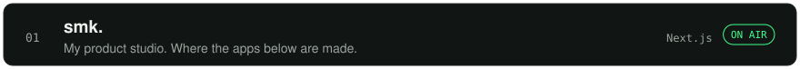
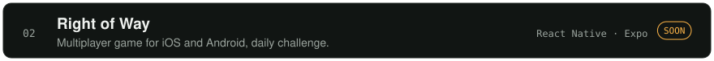
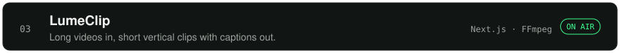
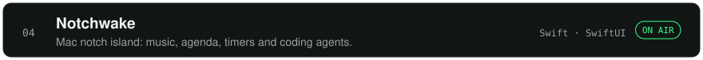
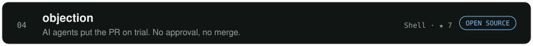
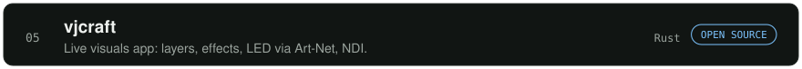

<!-- Cards are SVGs drawn by scripts/render_cards.py and refreshed daily by
     .github/workflows/cards.yml. -->

 
 
 
 
 
 
 
 
 

<a href="https://www.victorserpa.dev">victorserpa.dev</a> &nbsp;·&nbsp; <a href="https://www.linkedin.com/in/victorserpa/">linkedin</a> &nbsp;·&nbsp; <a href="https://wearesmk.com">smk.</a> &nbsp;·&nbsp; <a href="mailto:schmvitoor@gmail.com">email</a>

