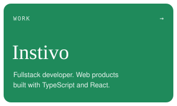
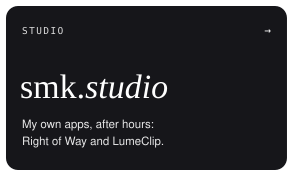
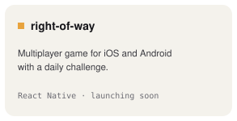
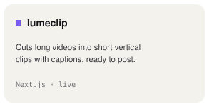
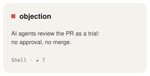

<!-- Cards are SVGs drawn by scripts/render_cards.py and refreshed daily by
     .github/workflows/cards.yml. Keep each row of cards on one line with no spaces between them. -->

 
 
 
 
<picture><source media="(prefers-color-scheme: dark)" srcset="./cards/title-dark.svg" /></picture> 

<picture><source media="(prefers-color-scheme: dark)" srcset="https://raw.githubusercontent.com/victorserpa/victorserpa/output/github-snake-dark.svg" /></picture>

<a href="https://www.victorserpa.dev">victorserpa.dev</a> &nbsp;/&nbsp; <a href="https://www.linkedin.com/in/victorserpa/">linkedin</a> &nbsp;/&nbsp; <a href="https://wearesmk.com">smk.</a> &nbsp;/&nbsp; <a href="mailto:schmvitoor@gmail.com">email</a>

