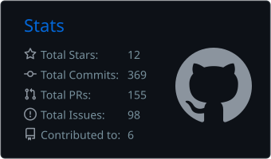
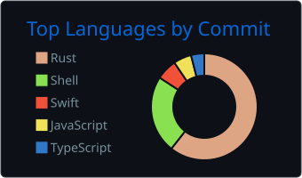

<p align="center"></p>

<h2 align="center">Victor Serpa</h2>

Fullstack developer at **[Instivo](https://instivo.com.br)**, living in Joinville, Brazil.

After hours I run **[smk.](https://wearesmk.com)**, a small studio where I ship my own apps. Right of Way and LumeClip are made there.

```ts
const victor = {
  work: ["TypeScript", "React", "Next.js", "Node.js"],
  sideProjects: ["Rust", "React Native", "AI tooling"],
  likes: "fast apps, simple code",
};
```


### Projects

| | |
|---|---|
| **[smk.](https://wearesmk.com)** | My studio's site. Right of Way and LumeClip live here. · `Next.js` `React` `Tailwind CSS` |
| **[Right of Way](https://playrightofway.com)** | Multiplayer game for iOS and Android with a daily challenge. Launching soon. · `React Native` `Expo` `Hono` `Postgres` |
| **[LumeClip](https://lumeclip.com)** | Cuts long videos into short vertical clips. Transcribes, finds the best moments, reframes and adds karaoke captions. · `Next.js` `Fastify` `FFmpeg` `BullMQ` |
| **[objection](https://github.com/victorserpa/objection)** | PR review for AI coding agents, set up as a trial. Accusers attack the diff, a defender answers, a judge decides. No approval, no merge. · `Shell` |
| **[vjcraft](https://github.com/victorserpa/vjcraft)** | Open-source VJ app for live visuals. Layers, clips, effects, LED via Art-Net, NDI and Syphon. · `Rust` |

### Stack

<p>
  &nbsp;
  &nbsp;
  &nbsp;
  &nbsp;
  &nbsp;
  &nbsp;
  &nbsp;
  &nbsp;
  &nbsp;
  &nbsp;
  &nbsp;
</p>

### Experience

- **Instivo**, Fullstack Developer (now)
- **SZ Soluções**, Fullstack Developer. Worked on BeeStock (WMS), client portals and B2B stores for Brazil and Chile

### Stats

<p>
  
  
</p>


<picture>
  <source media="(prefers-color-scheme: dark)" srcset="https://raw.githubusercontent.com/victorserpa/victorserpa/output/github-snake-dark.svg" />
  
</picture>

### Contact

[victorserpa.dev](https://www.victorserpa.dev) · [LinkedIn](https://www.linkedin.com/in/victorserpa/) · [schmvitoor@gmail.com](mailto:schmvitoor@gmail.com)
